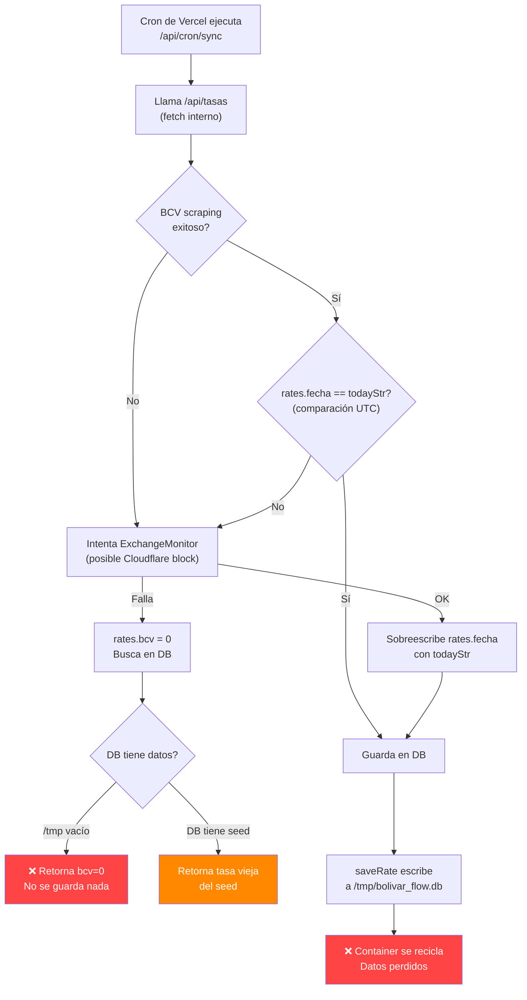

# 🔍 Diagnóstico Completo: Tasas No Actualizan — Bolívar Flow v2.0

> **Fecha del análisis**: 2026-10-12  
> **Analizado por**: Claude Opus 4.6 (Thinking)  
> **Problema reportado**: Las tasas BCV no se actualizan desde hace varios días  
> **Estado del fix**: ✅ Aplicado

---

## 📊 Síntoma Observado

El archivo `src/data/bcv/2026.json` muestra que el último dato real (source: `XLSX`) en octubre 2026 es del **05/10/2026** con USD `871.3689`. No se han insertado tasas nuevas del 06 al 12 de octubre.

La base de datos local (`data/bolivar_flow.db`) fue poblada el 28/09/2026 vía el `miner.js` y no ha recibido actualizaciones desde producción (Vercel).

---

## 🐛 Bugs Identificados (Prioridad Alta → Baja)

### BUG 1 — CRÍTICO: SQLite Efímero en Vercel (`/tmp` no persiste)

**Archivo**: [`src/lib/db.js`](file:///c:/Users/jpina/Documents/rybak.Software/bolivar-flow/src/lib/db.js)

**Problema**: Cuando la app corre en Vercel sin `DATABASE_URL` configurado, la base de datos se crea en `/tmp/bolivar_flow.db`. En Vercel Serverless:

- `/tmp` es **efímero** y se borra al reciclar el contenedor (cold start).
- Cada instancia serverless tiene su **propio `/tmp`** aislado.
- El cron graba en Container A → el usuario lee en Container B → **jamás ve la actualización**.

```javascript
// db.js línea 24-25
if (isVercel) {
    dbFilePath = "/tmp/bolivar_flow.db";  // ❌ EFÍMERO
}
```

**Impacto**: Toda escritura a la DB en producción se pierde eventualmente. El seed se re-ejecuta desde los JSON estáticos cada vez que un nuevo container arranca, así que siempre muestra los datos que fueron committed al repositorio, no las tasas "en vivo".

> [!CAUTION]
> **Este es el bug raíz**. Sin una base de datos persistente (Turso, PlanetScale, Neon, etc.), ningún fix de scraping importará porque las tasas escritas se pierden.

**Fix aplicado**: Se agregó un warning explícito cuando `VERCEL` está activo sin `DATABASE_URL`. Se recomienda **encarecidamente** configurar Turso (gratis) como DB remota.

---

### BUG 2 — ALTO: Desfase de Zona Horaria (UTC vs Venezuela UTC-4)

**Archivos afectados**:
- [`src/app/api/tasas/route.js`](file:///c:/Users/jpina/Documents/rybak.Software/bolivar-flow/src/app/api/tasas/route.js) (líneas 70-73)
- [`src/app/api/historico/route.js`](file:///c:/Users/jpina/Documents/rybak.Software/bolivar-flow/src/app/api/historico/route.js) (línea 23)
- [`src/lib/ratesRepository.js`](file:///c:/Users/jpina/Documents/rybak.Software/bolivar-flow/src/lib/ratesRepository.js) (línea 285)
- [`src/app/api/cron/sync/route.js`](file:///c:/Users/jpina/Documents/rybak.Software/bolivar-flow/src/app/api/cron/sync/route.js) (línea 10)

**Problema**: Todos usan `new Date()` que en Vercel retorna **UTC**. Venezuela está en **UTC-4**. Después de las 8:00 PM hora Venezuela (que es 00:00 UTC), `new Date().getDate()` retorna el **día de mañana**.

```javascript
// tasas/route.js línea 70-73
const now = new Date();  // ❌ UTC en Vercel
const todayStr = `${fd}/${fm}/${now.getFullYear()}`; // Es "mañana" después de 8PM VET
```

**Consecuencias**:
1. `todayStr` es el día de mañana → `rates.fecha !== todayStr` siempre true → siempre entra al fallback.
2. El fallback de ExchangeMonitor puede fallar (Cloudflare) → rates.bcv queda en 0.
3. Con bcv=0, entra al rescue de la DB → la DB está vacía (bug 1) → no hay tasa → devuelve 0.
4. En `historico`, `isCurrentMonth` calcula mal a fin de mes, generando fill-forwards erróneos.

**Fix aplicado**: Se creó `getVenezuelaDate()` en `db.js` que calcula la hora en UTC-4, y se reemplazó `new Date()` en todos los archivos afectados.

---

### BUG 3 — ALTO: Sobreescritura de Fecha Valor Oficial BCV

**Archivo**: [`src/app/api/tasas/route.js`](file:///c:/Users/jpina/Documents/rybak.Software/bolivar-flow/src/app/api/tasas/route.js) (línea 128)

**Problema**: El BCV a menudo publica la tasa con fecha de valor del **día siguiente** o del **lunes** (viernes por la tarde). El scraper del BCV extrae correctamente esta fecha. Pero la lógica del fallback la sobreescribe:

```javascript
// Línea 78: si la fecha del BCV no es HOY, entra al fallback
if (rates.bcv === 0 || rates.euro === 0 || rates.fecha !== todayStr) {
    // ...intenta ExchangeMonitor...
    if (rates.bcv > 0) {
        rates.fecha = todayStr;  // ❌ SOBREESCRIBE la fecha oficial del BCV
    }
}
```

**Consecuencia**: Si el BCV dice "fecha valor: 09/10/2026" pero `todayStr` es "08/10/2026", se fuerza a "08/10/2026". Al guardar en la DB con la fecha incorrecta, la tasa del 09 nunca aparece, y el 08 queda con datos duplicados.

**Fix aplicado**: Cambiado `rates.fecha = todayStr` a `if (!rates.fecha) rates.fecha = todayStr` — solo asigna si no se obtuvo fecha del BCV.

---

### BUG 4 — MEDIO: Promise Flotante en Serverless (`saveRatesBatch`)

**Archivo**: [`src/lib/ratesRepository.js`](file:///c:/Users/jpina/Documents/rybak.Software/bolivar-flow/src/lib/ratesRepository.js) (líneas 352-354)

**Problema**: En `getRatesForMonth`, los días rellenados se persisten con un `.catch()` fire-and-forget:

```javascript
saveRatesBatch(newItemsToPersist).catch(e => { ... });  // ❌ No await
```

En Vercel Serverless, la función se congela inmediatamente después de enviar la respuesta HTTP. Las promises no-awaited se terminan silenciosamente.

**Fix aplicado**: Se cambió a `await saveRatesBatch(...)` con try/catch.

---

### BUG 5 — MEDIO: `forceXlsx` No Implementado

**Archivo**: [`src/app/api/cron/sync/route.js`](file:///c:/Users/jpina/Documents/rybak.Software/bolivar-flow/src/app/api/cron/sync/route.js) (líneas 27, 29)

**Problema**: Los sweep-types `sweep-current` y `sweep-previous` envían `&forceXlsx=true` a `/api/historico`, pero el endpoint **nunca lee ni procesa** ese parámetro. Era probablemente la intención de disparar el miner desde el cron, pero la integración quedó incompleta.

**Fix aplicado**: Se removió el parámetro `forceXlsx` ya que no tiene efecto. Si se necesita Excel scraping automático, se debe integrar la lógica del `miner.js` como función invocable.

---

### BUG 6 — MEDIO: Cron Silencioso (No Reporta Fallos)

**Archivo**: [`src/app/api/cron/sync/route.js`](file:///c:/Users/jpina/Documents/rybak.Software/bolivar-flow/src/app/api/cron/sync/route.js) (línea 34)

**Problema**: `Promise.allSettled(promises)` se resuelve sin verificar si las sub-llamadas fallaron. Siempre retorna `{ success: true }`.

```javascript
await Promise.allSettled(promises);
return NextResponse.json({ success: true, ... });  // ❌ Siempre "éxito"
```

**Fix aplicado**: Se inspeccionan los resultados individuales y se retorna un `summary` con el status de cada endpoint.

---

### BUG 7 — BAJO: `isWeekend` Hardcodeado en `/api/tasas`

**Archivo**: [`src/app/api/tasas/route.js`](file:///c:/Users/jpina/Documents/rybak.Software/bolivar-flow/src/app/api/tasas/route.js) (línea 144)

**Problema**: `isWeekend: false` está hardcodeado. Si el BCV publica una tasa el viernes con fecha valor del sábado, se guarda como día hábil.

**Fix aplicado**: Se calcula dinámicamente basado en el día de la semana.

---

## 🏗️ Diagrama de Flujo del Problema



---

## ✅ Fixes Aplicados

| # | Archivo | Cambio |
|---|---------|--------|
| 1 | `src/lib/db.js` | Añadido `getVenezuelaDate()`, warning en Vercel sin `DATABASE_URL`, fix del fallback de directorio |
| 2 | `src/app/api/tasas/route.js` | Timezone fix, no sobreescribir fecha BCV, isWeekend dinámico |
| 3 | `src/app/api/historico/route.js` | Timezone fix con `getVenezuelaDate()` |
| 4 | `src/lib/ratesRepository.js` | Timezone fix, await de `saveRatesBatch` |
| 5 | `src/app/api/cron/sync/route.js` | Timezone fix, reporte de resultados, removido `forceXlsx` |

---

## 🚨 Acción Requerida: Configurar Base de Datos Persistente

> [!IMPORTANT]
> Los fixes de código solo resuelven la lógica. **El problema de fondo es que no hay base de datos persistente en producción.**

### Opción recomendada: Turso (Gratis)

1. **Crear cuenta**: https://turso.tech (gratis hasta 9GB)
2. **Crear base de datos**:
   ```bash
   turso db create bolivar-flow
   turso db show bolivar-flow --url   # Copiar la URL
   turso db tokens create bolivar-flow  # Copiar el token
   ```
3. **Configurar en Vercel**:
   - `DATABASE_URL` = `libsql://bolivar-flow-<tu-org>.turso.io`
   - `DATABASE_AUTH_TOKEN` = `<token generado>`
4. **Seed inicial**: Ejecutar `node src/miner.js` localmente con `DATABASE_URL` apuntando a Turso, o hacer un request a `/api/historico?mes=10&anio=2026` después del deploy para que el auto-seed popule desde los JSON.

### Alternativa: Mantener los JSON como fuente de verdad

Si no se quiere usar una DB externa, se podría:
- Eliminar la capa de DB del flujo de lectura
- Leer directamente de los archivos JSON (como hacía la v1)
- El `miner.js` sigue siendo necesario para poblar los JSON

Pero esto significaría que las tasas solo se actualizan cuando alguien corre `miner.js` manualmente y hace commit+deploy.

---

## 📁 Estructura de Archivos Relevantes

```
bolivar-flow/
├── src/
│   ├── lib/
│   │   ├── db.js                    # Conexión SQLite/Turso (FIJADO)
│   │   ├── ratesRepository.js       # CRUD de tasas (FIJADO)
│   │   └── utils.js                 # Formateadores (client-side)
│   ├── app/api/
│   │   ├── tasas/route.js           # Scraping BCV + EM (FIJADO)
│   │   ├── historico/route.js       # Datos mensuales (FIJADO)
│   │   ├── cron/sync/route.js       # Cron handler (FIJADO)
│   │   └── diferencial/route.js     # ⚠️ VACÍO (0 bytes)
│   ├── data/bcv/
│   │   └── 2026.json                # Datos estáticos (último: 05/10/2026)
│   └── miner.js                     # Scraper offline de Excel BCV
├── data/
│   └── bolivar_flow.db              # DB local (solo dev)
├── vercel.json                      # Config de crons
└── package.json
```

---

## 📝 Notas para Futuras LLMs

1. **Venezuela no tiene DST** — siempre UTC-4. Usar `getVenezuelaDate()` de `db.js`.
2. **BCV publica tasas con fecha valor adelantada** — no comparar con "hoy" para decidir si la tasa es válida.
3. **`miner.js` es offline** — usa CommonJS, no es importado por Next.js. Se ejecuta manualmente con `node src/miner.js`.
4. **`diferencial/route.js` está vacío** — el frontend lo llama pero no hay handler.
5. **Los JSON en `src/data/bcv/` son estáticos** — se commitean al repo. Solo se actualizan cuando se corre `miner.js` localmente.
6. **`exportYearToJson()` en `ratesRepository.js` no funciona en Vercel** — filesystem es read-only excepto `/tmp`.
7. **El cron de Vercel hace fetch loopback** — puede fallar si hay Deployment Protection activada.
